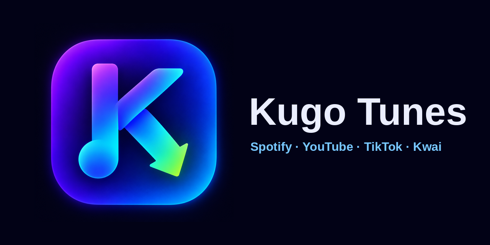

<div align="center">


# Kugo Tunes

**Download music and videos from your favorite platforms straight to your phone, organized and with cover art.**

[](https://github.com/Guizx-098/spd-turbo/releases/latest)
[](https://github.com/Guizx-098/spd-turbo/releases)
[](https://github.com/Guizx-098/spd-turbo/releases/latest)

[🇧🇷 Português](README.md) · **🇺🇸 English**

<br>



<br><br>

### [📲 Download the app](https://github.com/Guizx-098/spd-turbo/releases/latest)

</div>

---

## 🎯 How it works

1. Open Kugo Tunes and pick the platform.
2. Paste the link of the content.
3. Tap download. The file goes to the **Download/Kugo Tunes** folder on your phone, already sorted by platform.

No sign-up, no login and nothing to set up to get started.

## 📱 What you can download

| Platform | What it downloads | Details |
| :--- | :--- | :--- |
| 🎵 **Spotify** | Songs and playlists | You choose **MP3** or **M4A**, with title, artist and cover |
| ▶️ **YouTube** | Videos | Highest quality available; prefers the video's original audio |
| 🎧 **YouTube Music** | Songs | **MP3** or **M4A**, with title, artist and cover |
| 🎬 **TikTok** | Public videos | Highest quality available |
| 📸 **Instagram** | Public Reels | Highest quality available |
| 👍 **Facebook** | Public videos | Highest quality available |
| 📹 **Kwai** | Videos | Experimental feature |

## ✨ Highlights

- 🧭 **Simple home screen**: pick the platform and go, no confusing menus.
- 🏆 **Best quality**: the app always looks for the highest resolution the source offers.
- 🏷️ **Complete songs**: title, artist and cover saved inside the file.
- ⚡ **Several downloads at once**: from 1 to 4, as you prefer.
- 📁 **Everything in its place**: one folder per platform, created automatically.
- 🗂️ **Your own folder**: prefer another location? Change it in Preferences.
- 🔄 **In-app updates**: Kugo Tunes tells you when a new version is out, shows what's new and installs it for you.
- 🌐 **English and Portuguese**: switch the language whenever you want.
- 🌗 **Light and dark theme**.
- 📋 **Copied link, one tap**: copied a link? The app offers to download it right away, on the right platform.
- 📊 **Percentage on every item** in the queue.
- ⏯️ **Pause and resume**: continue where you stopped, without downloading again what is already done.
- 📶 **Wi-Fi only**: optional. If the internet drops, the app waits and goes on by itself.
- 🔁 **Resumes after closing the app**: when you open it, interrupted playlists show up so you can continue.
- 🧺 **Several lists at once**: leave one playlist downloading in the background and start another (Spotify, YouTube Music...).

## 📥 How to install

1. Open the [**Releases**](https://github.com/Guizx-098/spd-turbo/releases/latest) page.
2. Download the **Kugo-Tunes.apk** file.
3. Open the file on your phone and, if Android asks, allow installing apps from this source.
4. Done: open Kugo Tunes and start downloading.

> 💡 **Updating:** the app lets you know by itself. You can also use **Preferences → Check for updates**.
>
> If you have an old version installed that Android refuses to update, uninstall it once and install the new one. After that, updates install over it normally.

## 📁 Where the files go

```
Download/
└── Kugo Tunes/
    ├── Spotify/
    ├── YouTube/
    ├── YouTube Music/
    ├── Facebook/
    ├── Instagram/
    ├── TikTok/
    └── Kwai/
```

No file is ever replaced: if the name already exists, the new one gets a number at the end. On Android 10 or newer, the **Kugo Tunes** folder appears when the first file is saved.

## ❓ FAQ

**Is the video watermark-free?**
The app asks for the watermark-free version when the platform offers one, but that depends on the platform and cannot be guaranteed.

**Can I download private content, Stories or posts that need a login?**
No. Kugo Tunes only downloads public content and tells you why when a link cannot be downloaded.

**A download failed. Now what?**
The reason appears under the title in the queue. Platforms change often and may block access for a while; try again later.

**Does the app ask for a lot of permissions?**
Only a few: notifications (Android 13 or newer), Android's own permission to install the app's updates and, on Android 7 to 9 only, storage access to create the Kugo Tunes folder. If you pick another folder, Android grants access to that folder only.

**Why is the app big?**
Because it already includes everything it needs to read and process videos, without relying on third-party sites in most cases.

## 🔒 Privacy

- Kugo Tunes does not ask for an account or login.
- In rare cases when TikTok fails, the app may use an external service to read the video. In that case, **the video link is sent to that service**.

## ⚠️ Terms of use

Use Kugo Tunes only to download content you have the right to save, and respect each platform's terms. Kugo Tunes is an independent project, not affiliated with Spotify, YouTube, TikTok, Kwai, Instagram or Facebook. Names and trademarks belong to their respective owners.

## 👤 Creator

Developed by [**Guizx-098**](https://github.com/Guizx-098).

Ideas, problems or suggestions? [Open an issue](https://github.com/Guizx-098/spd-turbo/issues).

## 📜 License

See the [LICENSE](LICENSE) and [NOTICE.md](NOTICE.md) files.
