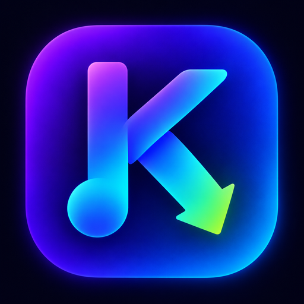

  

<h1 align="center">SPD Turbo</h1>

  
  
  

  <strong>Android app that downloads music and videos from Spotify, YouTube Music and YouTube straight to your phone, fully tagged, with cover art.</strong> 
  <em>App Android para baixar músicas e vídeos do Spotify, YouTube Music e YouTube, com metadados e capa.</em>

---

## ✨ Features

- 🎵 **Spotify playlists**: reads playlist metadata directly, no API keys or login. Links shared from the Spotify app are accepted through Android's share menu.
- ▶️ **YouTube Music and YouTube**: paste a song, video or playlist link (`music.youtube.com` = audio, `youtube.com` = video; with *Convert to MP3* on, audio only).
- ⚡ **Simultaneous downloads (1–4)**: set in Preferences (default 1). Each track runs its own download → convert → finish pipeline, and one failure never stops the others.
- 🎧 **MP3 conversion**: optional, applied to every track, with a strict check so a track is only "Complete" after the conversion really finished.
- 🏷️ **Embedded metadata and cover art**: title, artist and cover are written into every file.
- 🌐 **Languages**: English (default) and Português (Brasil), selectable in Preferences and remembered between sessions.
- 🚀 **In-app updates from GitHub Releases**: automatic check at startup (can be turned off), a *Check for updates* button, update dialog with release notes, APK download with progress and install, with a "Not now" option that is remembered per version.
- 📂 **Storage Access Framework**: choose any folder on your device to save the downloads.
- 🔄 **Queue management**: per-track status (waiting, downloading, processing, converting, complete, error), cancel and retry failed tracks.
- 🔔 **Background download service** with live progress in the notification.
- 🎨 **Material 3 design** with light and dark themes.

---

## 📥 Installation

1. Open the [**Releases**](https://github.com/Guizx-098/spd-turbo/releases/latest) page.
2. Download `SPD-Turbo.apk` from **Assets**.
3. Open the APK on your Android phone and allow installing from this source if Android asks.
4. Open **SPD Turbo**, choose the download folder in **Preferences** and start downloading.

**Updating:** the app tells you when a new Release is published. You can also use **Preferences → Check for updates**.

> All releases are signed with the same key, so updates install over the previous version. If you have an older build signed with a different key, uninstall it once before installing.

**Instalação (pt-BR):** baixe o `SPD-Turbo.apk` na página de [Releases](https://github.com/Guizx-098/spd-turbo/releases/latest), abra no celular e permita a instalação quando o Android pedir. Para atualizar, use **Preferências → Checar atualizações**.

---

## 🛠️ Tech Stack

| Component | Technology / Library |
| :--- | :--- |
| **UI Framework** | [Jetpack Compose](https://developer.android.com/jetpack/compose) (Material 3) |
| **Language** | Kotlin |
| **Audio / video sourcing** | [NewPipe Extractor](https://github.com/TeamNewPipe/NewPipeExtractor) |
| **Media processing** | [FFmpeg Kit](https://github.com/arthenica/ffmpeg-kit) |
| **HTTP client** | [OkHttp](https://github.com/square/okhttp) |
| **Updates** | GitHub Releases API + Android PackageInstaller |

---

## 🚢 Publishing a release (maintainer)

1. Update `versionCode` / `versionName` in `app/build.gradle.kts` and the notes in `RELEASE_NOTES.md`.
2. Push to `main` with the commit message exactly `vX.Y.Z` (e.g. `v2.1.0`).
3. GitHub Actions builds the signed APK and publishes the Release with `SPD-Turbo.apk`. The in-app updater reads that Release.

---

> SPD Turbo is a modified version of [spotify-playlist-downloader](https://github.com/supersu-man/spotify-playlist-downloader) by Sumanth (MIT).

## 🤝 Contributing

Ideas or bugs? **[Create an issue](https://github.com/Guizx-098/spd-turbo/issues)**.

## 📜 License

Distributed under the **MIT License**. See [LICENSE](LICENSE).
